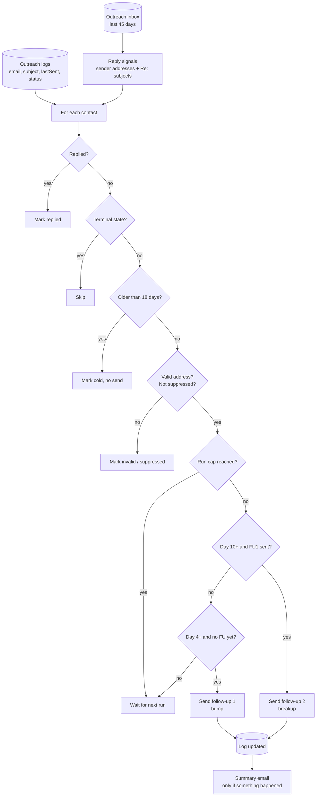

# Follow-Up Sequencer: a follow-up cadence that knows when to stop

A scheduled job that works through outreach logs every weekday and sends the right follow-up to the right contact: a short bump on day 4, a breakup note on day 10, and nothing after day 18. Before every send it checks the inbox for a reply, the address for validity and the suppression list for a bounce.

## The problem

A lot of replies to cold outreach come from the follow-up, not the first email. Doing follow-ups by hand does not survive a busy week, and automating them created problems of its own:

- **Zombie follow-ups.** After downtime, the job could wake up and "follow up" on emails that were months old.
- **Following up on people who had answered.** Replies sometimes came from a different address than the one pitched, so matching on sender alone missed them.
- **Following up on garbage.** Addresses scraped from HTML included image filenames like `logo@2x.png`, which were pitched, bounced, and then followed up.
- **Double sends.** Two engines working the same log each sent their own follow-up.

## What it does

`src/follow-up.js` runs on weekdays. For every contact in every configured log:

| Contact state | Action |
|---|---|
| A reply is in the inbox (sender or subject match) | Marked `replied`. No send |
| Already replied, cold, suppressed, invalid, or finished the sequence | Skipped |
| Older than 18 days | Marked `cold` **without sending** |
| Address is malformed or filename-shaped | Marked `invalid-email`. No send |
| Address is on the suppression list | Marked `suppressed`. No send |
| 10+ days old and got follow-up 1 | Follow-up 2: the breakup note |
| 4+ days old and only got the first email | Follow-up 1: a bump with one concrete idea |
| Anything else | Left to wait |

At most 10 emails go out per run, 45 to 90 seconds apart, and the owner gets a summary only when something happened.

## Architecture



## Key design decisions

**Old contacts go cold without an email.** The cold check runs before the send checks. A contact past the window is closed silently, whether or not it ever received a follow-up. Downtime can never turn into a burst of stale emails.

**Replies are detected two ways.** The job reads the last 45 days of the outreach inbox and collects sender addresses and normalized `Re:` subjects. A contact counts as replied if either matches, which catches the common case of an answer from a different person at the same company.

**The order of checks is the safety model.** Replied, then terminal, then cold, then address validity, then suppression, then the run cap, and only then the cadence. Every reason not to email someone is evaluated before any reason to email them.

**Addresses are validated as addresses.** `src/email-validation.js` rejects filename-shaped strings (`@2x.png`, font and script extensions), version-number local parts and malformed domains. It also exposes an MX check for sender scripts to use before a first pitch.

**One engine per log.** `OUTREACH_LOG_FILES` lists exactly which logs this job owns. A sender with its own follow-up cycle is left out on purpose, and the header comment says why.

**The breakup is the second and last follow-up.** The day 10 note says it is the last one and leaves the door open. Two follow-ups, then stop.

**Copy is config.** Both templates live in `config/templates.json` with `{{site}}` and `{{signature}}` placeholders. The cadence and the per-run cap are env vars.

**Dry run shows every decision.** `--dry-run` reads the inbox, walks the logs and prints what it would do without sending or writing. `npm run sample` generates a small log covering every branch and dry-runs it with no credentials.

## Repository layout

```
src/follow-up.js            reply signals, safety checks, cadence, summary email
src/email-validation.js     address validation, MX check, suppression list helpers
src/config.js               env + config/*.json loader, log file list
config/                     example company identity and follow-up templates
scripts/make-sample-log.js  sample log with relative dates for an offline dry run
.github/workflows/          weekday run, state carried in the Actions cache
```

## Setup

Requires Node 20+ and an outreach mailbox with SMTP and IMAP access.

```bash
npm install
npm run sample                                          # offline dry run on a generated log
cp .env.example .env                                    # fill in values
cp config/company.example.json config/company.json
cp config/templates.example.json config/templates.json
npm run dry-run                                         # your real logs, nothing sent
npm run follow-up
```

| Variable | Purpose |
|---|---|
| `OUTREACH_SMTP_HOST`, `OUTREACH_SMTP_PORT`, `OUTREACH_SMTP_USER`, `OUTREACH_SMTP_PASS`, `OUTREACH_FROM_EMAIL` | Sending follow-ups from the outreach mailbox |
| `OUTREACH_IMAP_HOST` | Reading replies from the same mailbox |
| `GMAIL_USER`, `GMAIL_APP_PASSWORD`, `EMAIL_NOTIFY` | Run summary to the owner |
| `OUTREACH_LOG_FILES` | Comma-separated logs this job owns. Relative paths resolve against `STATE_DIR` |
| `SUPPRESSION_FILE` | Path to the suppression list, usually the one maintained by [ai-reply-triage](https://github.com/Michael-Wootan/ai-reply-triage) |
| `FOLLOWUP_1_DAYS`, `FOLLOWUP_2_DAYS`, `COLD_DAYS`, `MAX_SENDS_PER_RUN` | Cadence and cap. Defaults 4, 10, 18 and 10 |
| `SENDER_NAME`, `CONFIG_DIR`, `STATE_DIR` | Optional overrides |

A log is any JSON object keyed by site or contact, where each entry has `email`, `subject`, `lastSent` and `status`. The logs hold real contacts, so `state/` is gitignored and travels between runs in the Actions cache.

Scheduled runs are off by default. Set the repository variable `ENABLE_SCHEDULE` to `true` to turn the schedule on; manual runs from the Actions tab always work.

---

Extracted from a production automation suite I built and ran for a live e-commerce and B2B wholesale business, 2026.

© Michael Wootan. Source shared for portfolio review; all rights reserved.
